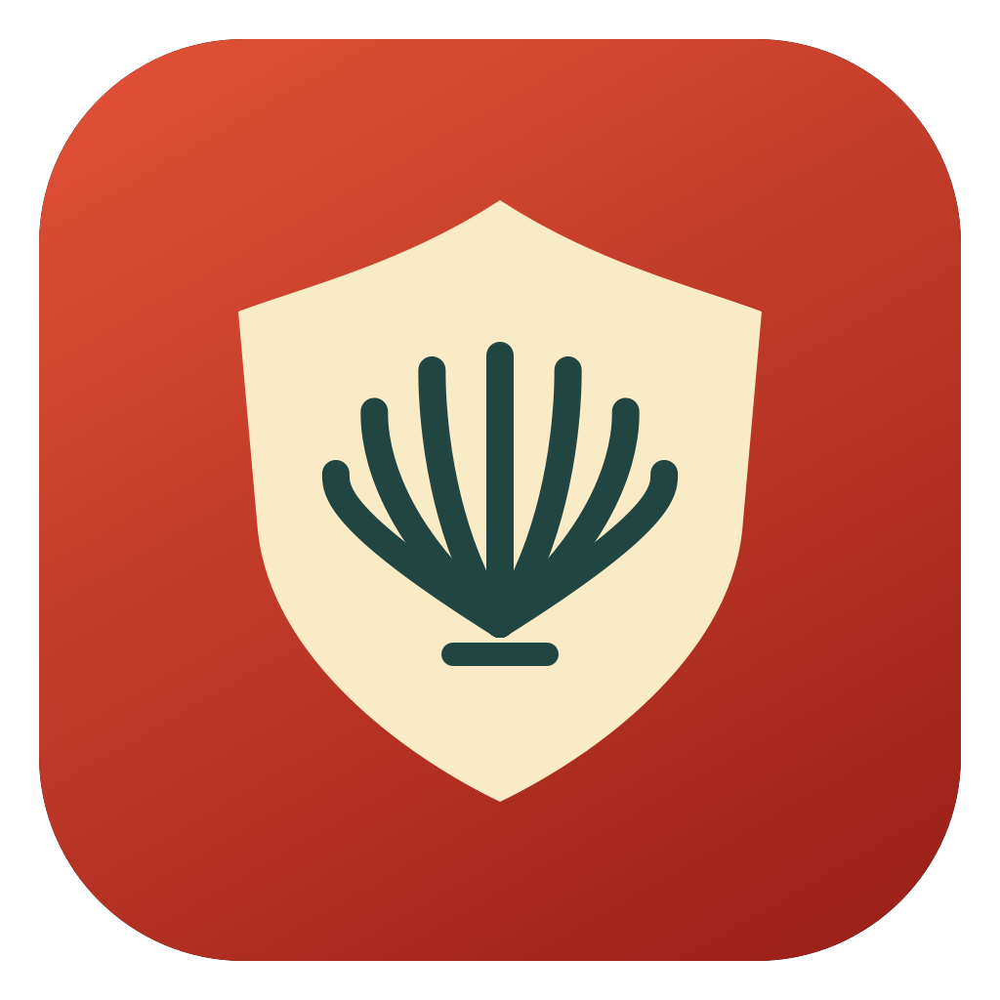
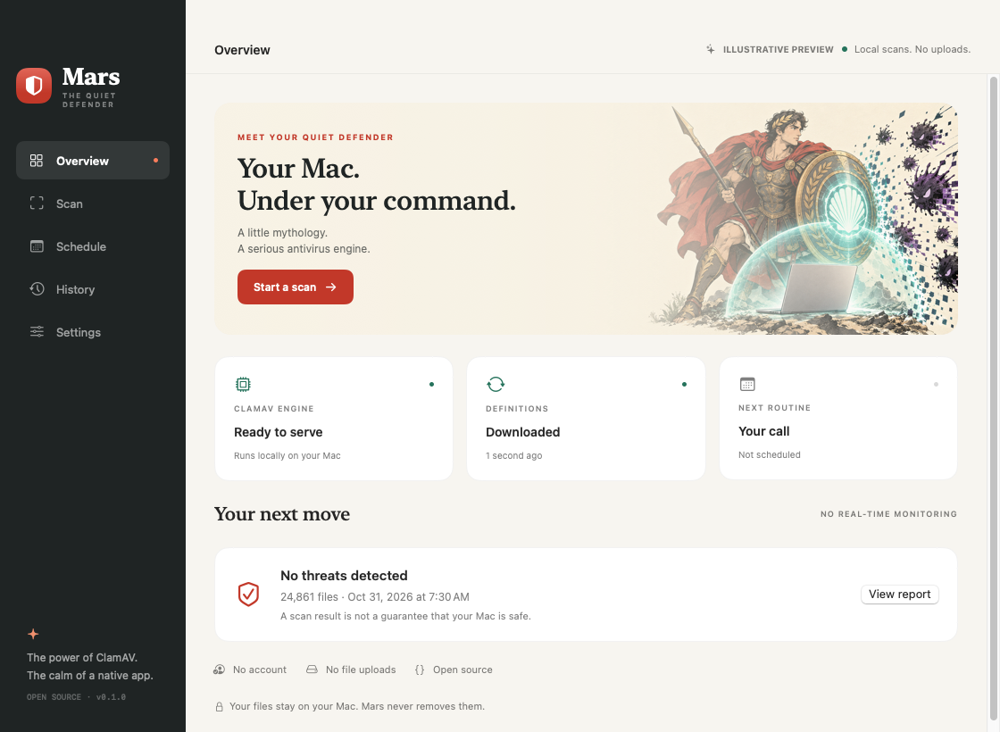
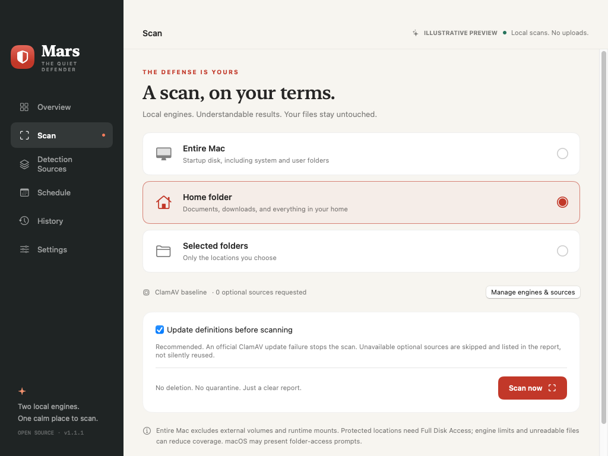
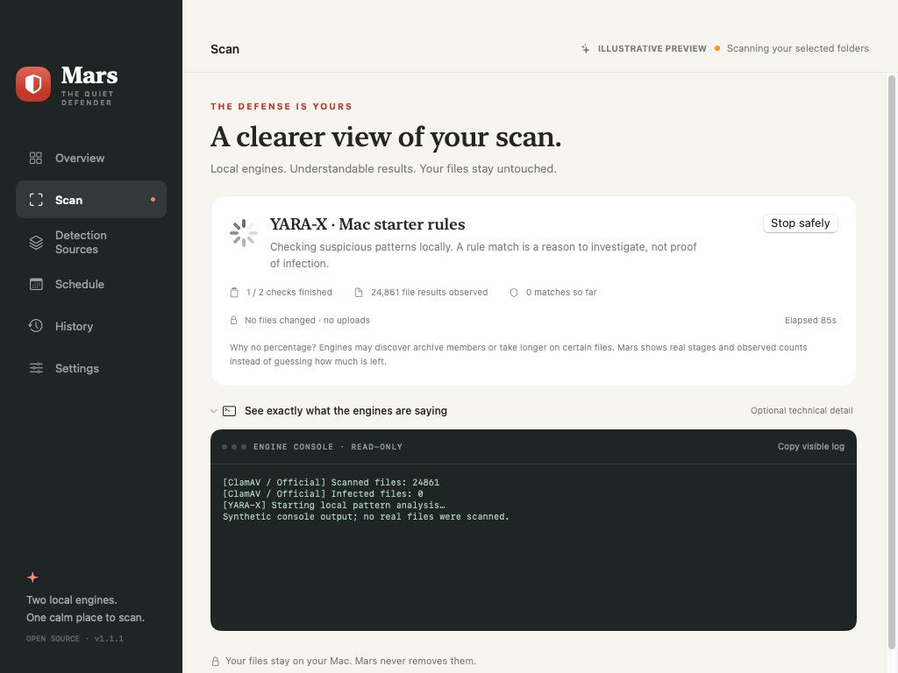
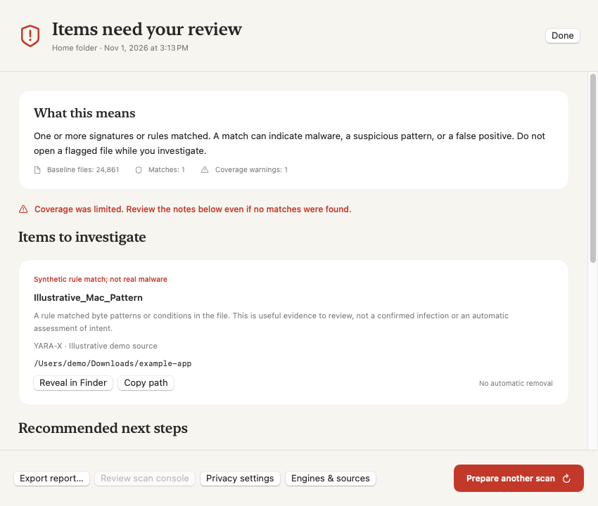
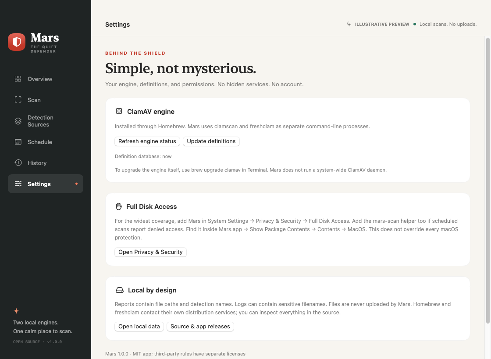

<div align="center">
  
  <h1>Mars</h1>
  <p>Your Mac. Two local engines. One calm place to scan.</p>
  <p>
    <a href="https://github.com/paulfxyz/mars/releases"></a>
    <a href="LICENSE"></a>
    
    
    <a href="https://github.com/paulfxyz/mars/actions/workflows/ci.yml"></a>
  </p>
  <p><a href="https://github.com/paulfxyz/mars/releases">Download for Mac</a> · <a href="INSTALL.md">Install guide</a> · <a href="CHANGELOG.md">Changelog</a> · <a href="PRIVACY.md">Privacy</a> · <a href="CONTRIBUTING.md">Contribute</a></p>
  
</div>

## A little mythology. A serious antivirus engine.

Mars is a native macOS companion for ClamAV and optional YARA-X. Install the engines, choose your detection sources, and scan a folder, your home, or your startup disk without learning command-line flags.

The Roman god of war lends his name, not a promise of invincibility. Mars is an on-demand scanner with optional daily or weekly routines, not real-time protection. It never deletes, moves, or quarantines your files.

## Install and get started

1. Download **Mars-1.1.1-macOS-universal.zip** from [Releases](https://github.com/paulfxyz/mars/releases).
2. Extract it, move **Mars.app** to Applications, then open it.
3. Choose **Set up Mars**. Confirm installation of ClamAV through Homebrew; Mars then downloads the official definitions. If Homebrew is missing, Mars offers to open its official installer in a visible Terminal window first.
4. Choose **Scan**, select a location, and scan. For wider coverage, grant Full Disk Access in macOS Settings.
5. Optionally save a daily or weekly schedule. Reports from both manual and background scans appear in History.
6. In **Detection Sources**, optionally install YARA-X, enable its scan switch, review source terms, configure any required account, **Update & validate** the rule source, then enable it. Accepting terms alone never enables a source.

**Ad-hoc signed, not Developer ID signed or notarized.** The app supports Apple silicon and Intel Macs on macOS 13 or later; optional Homebrew components have their own compatibility requirements. Version numbers are not a claim of an external security audit. macOS may require explicit approval in Privacy & Security; do not disable Gatekeeper or management policies.

## What you get

- **A proper Mac app:** SwiftUI and AppKit, native folder pickers, keyboard shortcuts, menu-bar access, light and dark appearances. No Electron, browser wrapper, account, or backend.
- **Guided engine setup:** Install ClamAV using Homebrew, with visible progress and explicit consent. Homebrew installation, if needed, happens separately in Terminal.
- **Definition updates:** Run `freshclam` manually or before each scan. Mars keeps its own user-owned database and configuration; it does not rewrite global ClamAV settings.
- **Three scan scopes:** Entire Mac, your home folder, or selected folders. Entire Mac targets the startup disk, excluding external volumes and runtime mounts; select an external volume explicitly to scan it.
- **Daily and weekly routines:** A per-user LaunchAgent invokes the bundled background helper. The window and app may be closed. You must remain logged in, and the Mac must be awake or subsequently wake.
- **Honest reports:** Detections, engine exit status, warnings, scanned-file count, scope, timestamps, and local raw logs. Failed and cancelled scans are never presented as clean.
- **Non-destructive by default and by design:** Reveal a flagged file in Finder and export a JSON report. No automatic deletion, relocation, or quarantine.
- **No fake progress:** An indeterminate activity indicator and live engine output, not an invented completion percentage.
- **Two local engines:** ClamAV baseline scanning and optional YARA-X raw-file rule analysis. Engine and source appear on each finding; repeated source-pass counts are not added together as unique files.
- **Selectable sources:** Official ClamAV, a pinned four-file Elastic Mac starter pack, user-owned SecuriteInfo feeds, and trusted local imports for both engines.
- **Understandable scanning:** Plain-language stages, observed counts, elapsed time, safe stopping, and an expandable dark read-only terminal.
- **Results that help:** Explanations, coverage gaps, source-by-source status, recommended next steps, Finder reveal, copy path, report export, and explicit preparation of a new scan.
- **App updates inside Mars:** Manual stable-release checks and SHA-256 verified ZIP downloads, with preserved macOS quarantine metadata. Installation remains an explicit Finder replacement, not a silent app swap or restart.

Version 1.1.1 creates an empty private SecuriteInfo configuration on first launch, preserves existing URLs, and leaves unconfigured subscriptions off with neutral setup guidance instead of stale errors. Unreliable automatic Sanesecurity downloads have been removed, including legacy enabled profiles; existing local files and historical reports are retained.



The screenshot is captured from the running native app in `--demo` mode. Its report and file count are synthetic, not evidence of a scan of someone's Mac. The guardian illustration is AI-generated original artwork, not a screenshot, an official ClamAV mascot, or an affiliation claim.





<details>
<summary>See how Mars explains a result</summary>
<p>This is an explicitly synthetic example, not a real detection on a user's Mac.</p>

</details>

<details>
<summary>App updates, without surprise installations</summary>
<p>Settings can check the official stable release and download its exact ZIP with SHA-256 integrity verification. Installation remains an explicit Finder replacement, and normal macOS approval is preserved.</p>

</details>

Explore the [native screenshot gallery](docs/SCREENSHOTS.md), including scheduling, history, settings, dark mode, and the minimum window size. The original app icon is available as [PNG](assets/app.png) and [macOS ICNS](assets/app.icns); the [identity notes](assets/README.md) explain the character, palette, and visual boundaries.

## Detection sources, not a mystery bundle

All unofficial sources are opt-in. Mars stages each update, validates it with the target engine, then activates it under the cross-process scan lock; a previous validated copy remains available for rollback. A successful compilation or authentication check does not establish detection accuracy.

- **Official ClamAV:** FreshClam maintains the baseline database.
- **Elastic Mac starter rules:** Four selected malware-family rule files, plus their license, are fetched directly from a pinned Elastic commit and must match pinned SHA-256 hashes. This is a small starter collection, not all Mac malware detection, and its [Elastic License 2.0](https://github.com/elastic/protections-artifacts/blob/main/LICENSE.txt) is separate from Mars's MIT license.
- **SecuriteInfo:** Optional and disabled until configured, validated, and explicitly enabled. Mars creates an empty private `.txt` file without overwriting existing URLs; an empty list is a normal setup state, not an error. Add your own authorized official HTTPS download URLs. Mars neither supplies a subscription nor redistributes paid definitions; see [the provider FAQ](https://www.securiteinfo.com/clamav-antivirus/faq-clamav-unofficial-signatures_en.shtml).
- **Local imports:** Add trusted ClamAV definitions, ClamAV-compatible standalone YARA, or YARA-X rules. Includes and compiled YARA are rejected; engine compilation/loading must succeed before activation. Imports do not update automatically and retain their own licenses.

YARA-X is a separate pattern-matching engine with a [BSD-3-Clause license and Homebrew package](https://formulae.brew.sh/formula/yara-x), not a source of automatically licensed rules. Mars scans raw candidate files up to 32 MiB, with a 500,000-file enumeration cap, no symlink following, and a one-hour per-source timeout. Archives are not unpacked by this second engine; ClamAV's baseline archive inspection remains separate. Coverage limitations are surfaced rather than silently counted as clean.

SecuriteInfo URLs are stored in a user-only 0600 file inside Mars's 0700 local data directory, not Keychain. Temporary curl configuration is also 0600, so private URLs are not command-line arguments. URLs do not enter scan reports, exports, or displayed console output; other processes with your user privileges can still read your local files.

## Quiet defense, clear boundaries

```text
Confirm engine installation → Homebrew installs ClamAV
                                      │
Download official definitions → User-owned local database
                                      │
Manual scan or macOS schedule → clamscan, as your user
                                      │
                     Local report + warnings + raw log
                                      │
                      You decide what happens next
```

Homebrew installation and ClamAV setup follow the [official macOS installation guidance](https://docs.clamav.net/manual/Installing/Packages.html). Definition downloads use ClamAV's [FreshClam update mechanism](https://docs.clamav.net/manual/Usage/SignatureManagement.html).

Mars serializes scans, installations, and definition updates with a shared process lock. A background job cannot silently overlap a GUI engine operation; it exits if the engine is busy. The lock is released by macOS if its owner crashes.

## What to expect

- **Not a safety guarantee:** No scanner detects everything. A completed scan means no detections among inspected files, not that the entire machine is safe.
- **Permissions matter:** Full Disk Access improves coverage but does not bypass all macOS protections. Scheduled helper access can differ from app access; check the first background report.
- **Coverage has limits:** Symlinks are not followed. ClamAV's default file, archive, recursion, and scan-size limits remain in effect. Exceeded-limit alerts are enabled and reported; unreadable files and engine warnings reduce coverage.
- **Entire Mac can be slow:** It scans `/`, including accessible system and user paths. macOS mount aliases may cause duplicate inspection, so file counts are engine-reported, not unique-file counts. External volumes and runtime mounts are excluded.
- **Freshness is a signal:** Definition age uses the local `daily.cvd` or `daily.cld` modification time, not a cryptographic assessment of current upstream freshness. Older than 48 hours is flagged. A failed official pre-scan update stops the scan; failed optional updates are reported as skipped checks while the baseline continues.
- **No always-on engine:** No kernel extension, Endpoint Security agent, `clamd` daemon, network filter, or on-access monitoring is installed by Mars.
- **App updates are manual:** Check and download inside Settings, then explicitly replace the app in Finder. Definition updates do not upgrade the ClamAV engine; use `brew upgrade clamav` for that.
- **Sleeping is sleeping:** Mars does not keep the Mac awake or schedule power-on. Missed runs are subject to macOS launchd behavior, and a busy engine skips that occurrence.

## Local data and privacy

Data lives in `~/Library/Application Support/mars/`: preferences, official definition databases, reports, and logs. Reports contain filenames and detection names; review exports before sharing. Mars retains the latest 200 reports and their associated scan logs; each raw scan log is capped at approximately 32 MiB.

Mars has no telemetry or project-operated relay. Scanned files are not uploaded by Mars. Homebrew and FreshClam contact their respective distribution infrastructure; manual app-update checks contact GitHub, and buttons can open documentation in your browser. See [Privacy](PRIVACY.md) and [Security](SECURITY.md) for details.

## Develop and test

Requires macOS 13+, Xcode Command Line Tools with Swift 5.9 or later, and Homebrew for engine integration.

```sh
git clone https://github.com/paulfxyz/mars.git
cd mars
swift test
swift run mars
```

For engine integration tests and a universal app bundle:

```sh
brew install clamav yara-x
MARS_CLAMAV_TESTS=1 swift test
bash scripts/package.sh
open dist/Mars.app
```

Packaging builds both arm64 and x86_64, embeds the standalone scheduled-scan helper, creates an original shield icon, and verifies the ad-hoc signature and universal architectures. It produces a ZIP and SHA-256 checksum under `dist/`. The [macOS CI workflow](https://github.com/paulfxyz/mars/actions/workflows/ci.yml) runs unit tests, a real-engine harmless custom-signature fixture, packaging, and native screenshot capture.

Tests do not establish real-world malware detection quality, Full Disk Access on your Mac, Homebrew authentication, or unattended scheduling across every sleep and login condition. See the versioned [validation notes](docs/VALIDATION.md).

## Open source, honestly

### Disclaimer: 100% vibe coding

Built by **Paul Fleury** with AI assistance. I am an entrepreneur building useful software with AI, not presenting this as the work of a traditional full-time software engineer.

The code is open so it can be inspected, challenged, and improved. Tests and explicit limitations matter more than claims of perfection. Treat this as a community utility, not a replacement for sensible security practices or a professional incident-response tool.

Mars is independent from and not affiliated with or endorsed by Apple, Cisco, the ClamAV project, or Homebrew. “Powered by ClamAV” describes use of a separately installed engine, not an official partnership. Mars is an original mythology-inspired character, not a video-game character.

## License

MIT for Mars source and original repository artwork; see [LICENSE](LICENSE). ClamAV is installed separately, not bundled or relicensed by Mars. It and its signatures retain their own licenses and terms.
