# Mars native interface

These screenshots were captured from the running SwiftUI/AppKit app, not generated interface mockups. Every capture uses `--demo` mode with clearly labeled synthetic data; a displayed scan result is illustrative, not evidence of a scan of a real Mac.

## Overview

The original guardian illustration anchors the warm ivory dashboard. Engine readiness, definition freshness, and the saved schedule remain separate from scan results.

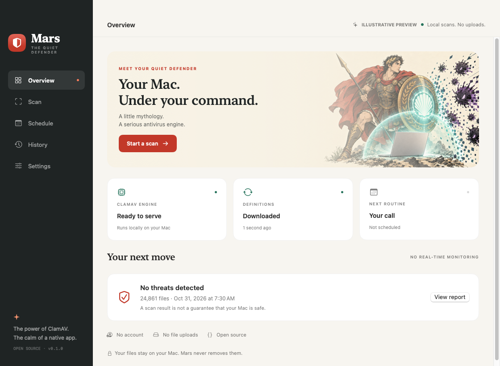

## Manual scan

Choose the startup disk, home, or selected folders. Pre-scan definition updates are enabled by default, and scanning never removes files.

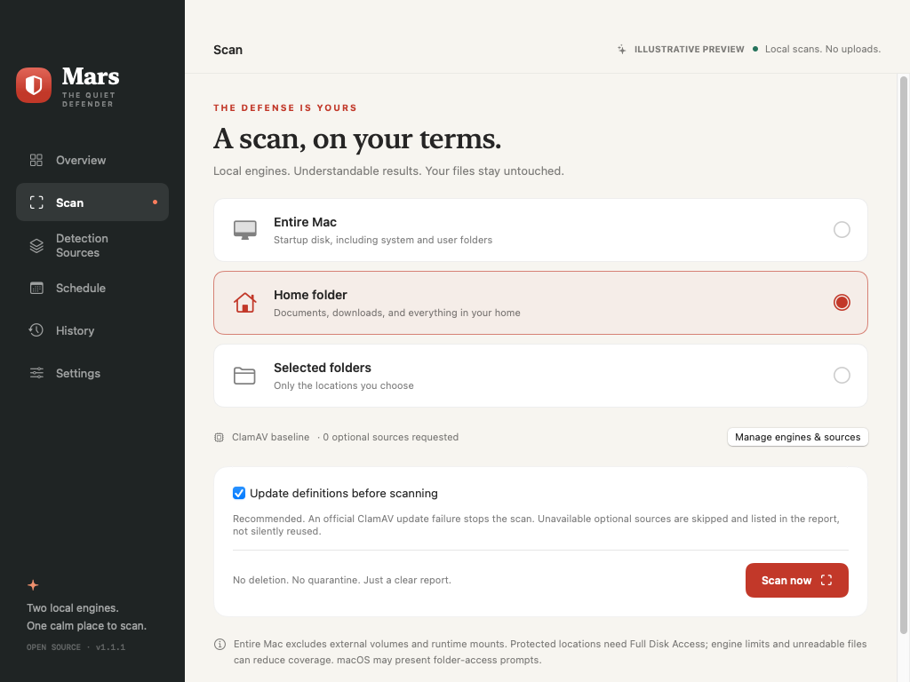

## Detection sources

ClamAV remains the baseline, with optional YARA-X inclusion and source-by-source consent, validation, freshness, license, and rollback controls. The source list is a normal scrollable native screen.

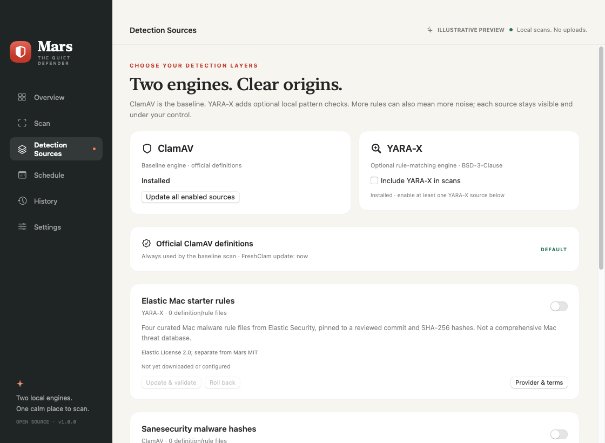

## During a scan

Plain-language stages, honest counters, elapsed time, safe stopping, and an expandable read-only terminal stay together. Synthetic progress does not imply that a real machine was scanned.

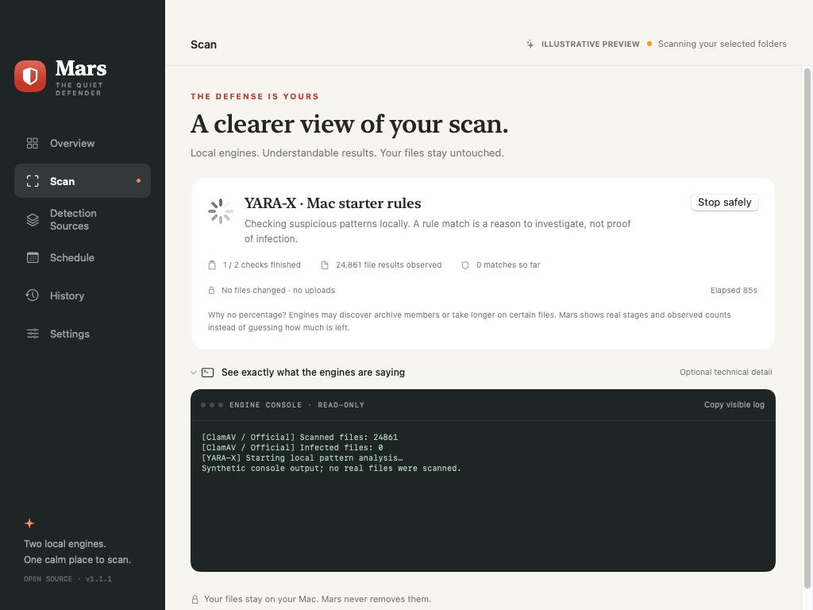

## Understanding the result

The report explains what a match means, identifies its engine/source, lists coverage gaps and suggested next steps, and offers safe actions. The example is a deliberately synthetic rule match, not a malware sample.

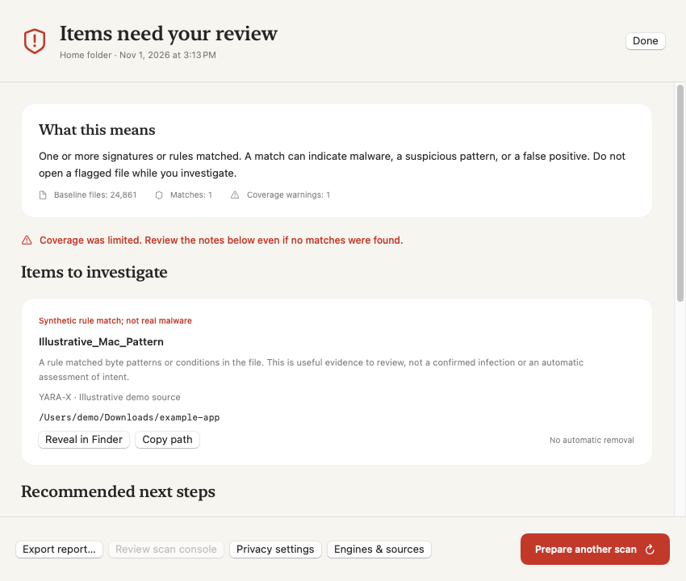

## Scheduled routines

Daily and weekly choices are saved explicitly to a per-user macOS LaunchAgent. This is a normal scrollable window; further controls are below the captured viewport.

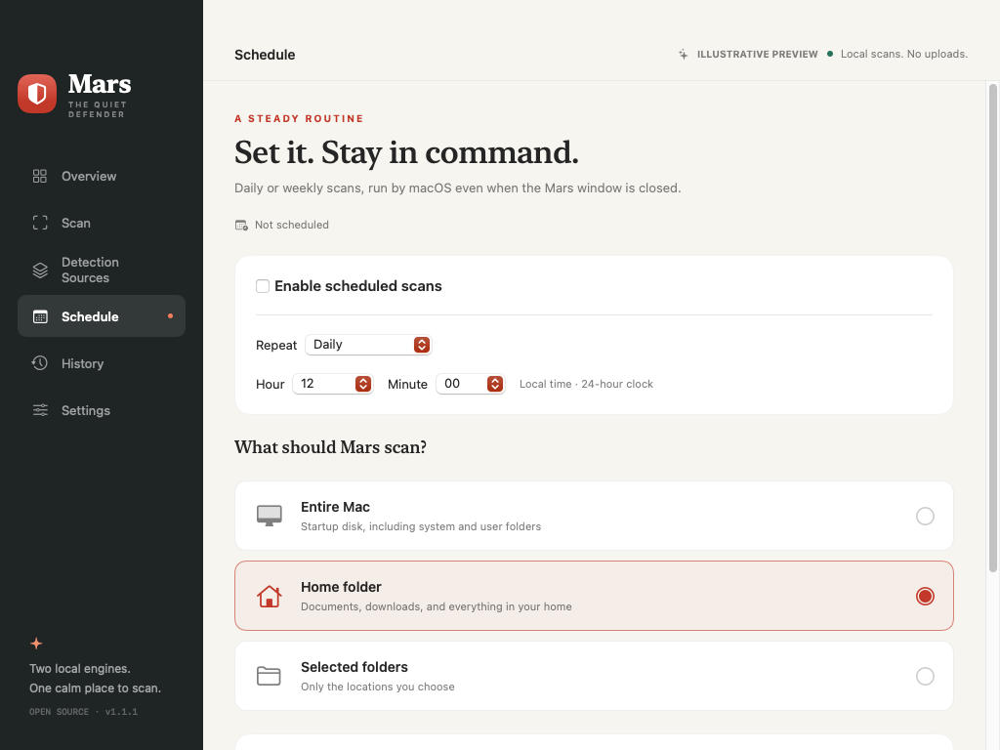

## Local history

Reports separate completed, detected, incomplete, failed, and cancelled outcomes. This capture contains one synthetic completed report.

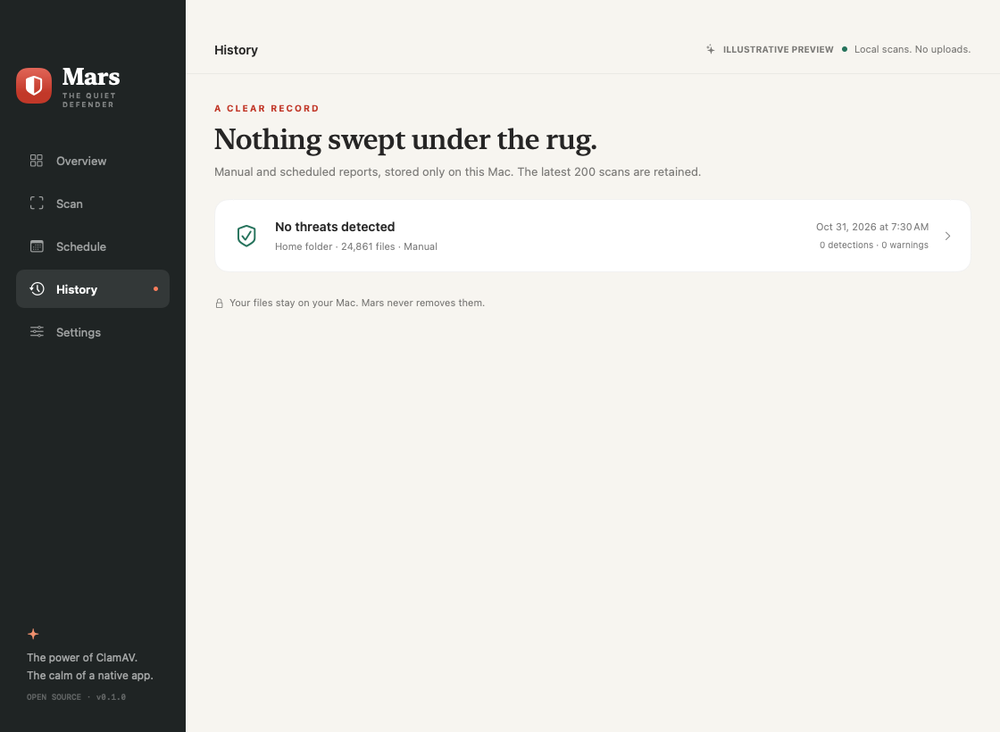

## Engine and permissions

Engine setup, definition updates, Full Disk Access guidance, local data, and source access share a straightforward settings screen. The last footer continues below the captured viewport.

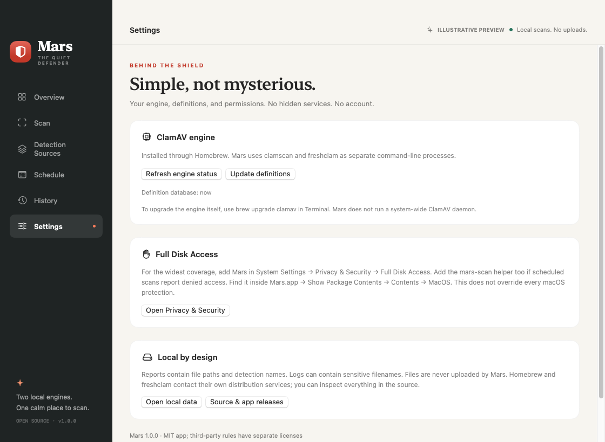

## Dark appearance

The interface adapts its native surfaces while retaining the warm guardian artwork. Outcome labels accompany color so results do not depend on color alone.

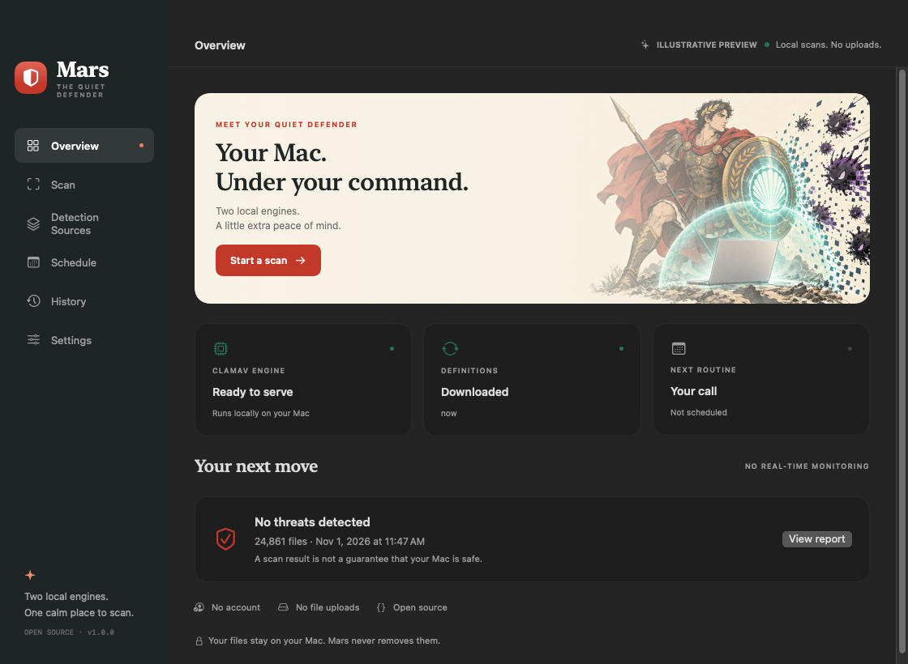

## Minimum window

At the minimum 1020×740 content size, navigation and primary actions remain available. Content scrolls vertically rather than squeezing into overlapping columns.

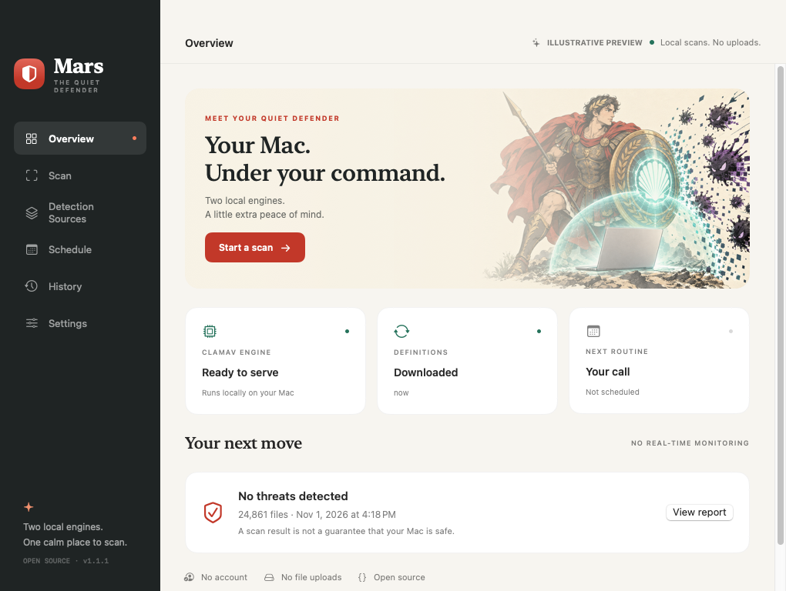

## App icon

The shield and original clam-fan motif echo the guardian's artwork in a legible small-format mark. Both [PNG](../assets/app.png) and [ICNS](../assets/app.icns) formats are committed.

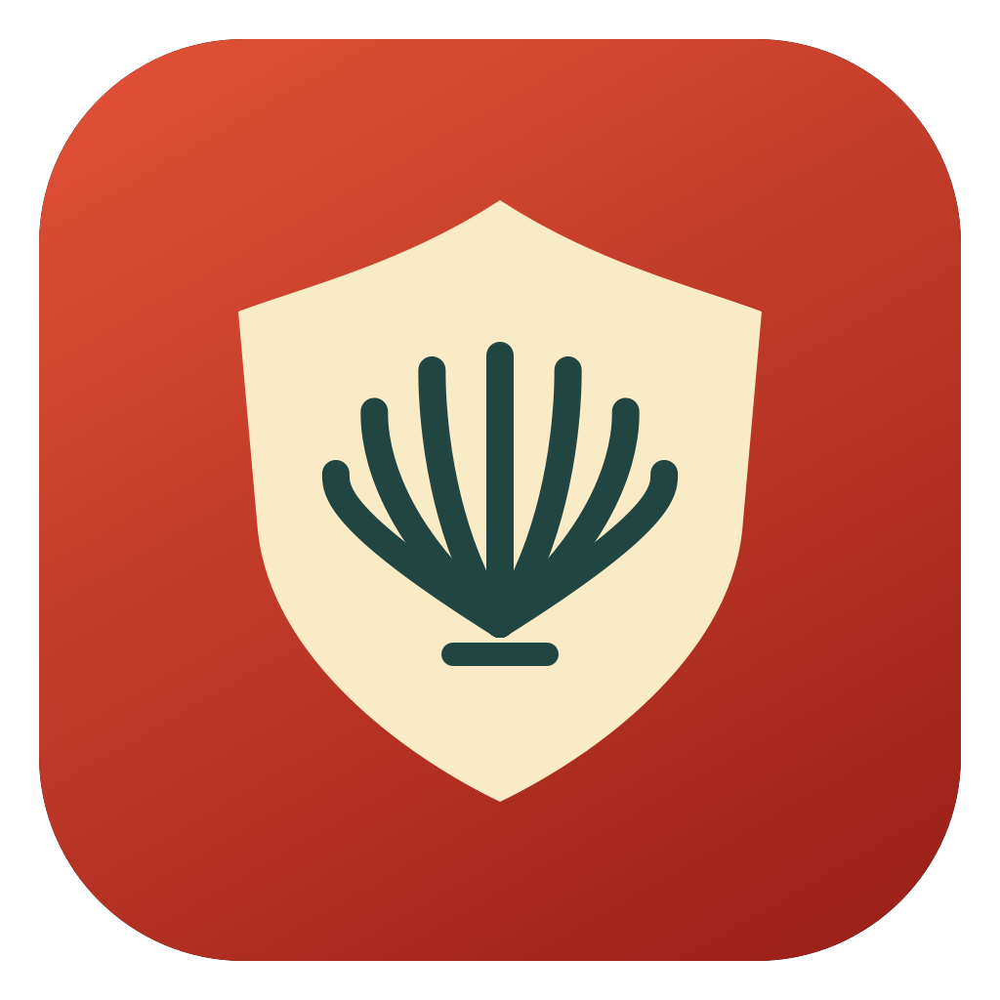
